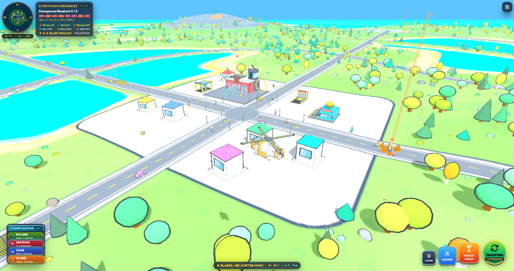

# Griffin Rock Rescue Bots: 3D Open World

An interactive 3D open-world fan game inspired by *Transformers: Rescue Bots*. Explore the 10x island of Griffin Rock, drill deep into the Subterranean Caverns, repair and launch **Starship Sigma**, chart the entire **3D Solar System**, race on Saturn's rings, and transform across **Bot, Vehicle, Boat, and Dinobot** modes with your AI wingman partner.



---

> ### ⚠️ Legal Disclaimer & Unofficial Fan Project Notice
>
> **This is an unofficial, non-commercial fan tribute project.**
>
> - **TRANSFORMERS**, **RESCUE BOTS**, and all associated characters, names, vehicle designs, logos, and fictional settings (including *Optimus Prime*, *Boulder*, *Heatwave*, *Chase*, *Blades*, *Bumblebee*, *Blurr*, *Salvage*, *High Tide*, *Quickshadow*, *Dr. Morocco*, and *Griffin Rock*) are registered trademarks and copyrights of **Hasbro, Inc.**
> - This software is **not** produced, authorized, sponsored, or endorsed by Hasbro, Inc. or any of its affiliates.
> - This project is completely **free and non-commercial**. There are **no ads, no microtransactions, and no donations or monetization** of any kind.
> - The source code and procedural algorithms are shared under the [MIT License](LICENSE) for educational and learning purposes. The MIT license applies **solely to the original software code** and does not grant any rights to Hasbro's intellectual property.
> - For full details, please review the [NOTICE](NOTICE) file.

---

## Features

### 11 Playable Rescue Bots (4 Modes Each + Mega Modes)
Transform seamlessly between **Bot Mode**, **Vehicle Mode**, **Amphibious Boat Mode** (automatic on water), and **Dinobot Mode**:

| Rescue Bot | Vehicle Mode | Boat Mode | Dinobot Mode | Unlock |
| :--- | :--- | :--- | :--- | :--- |
| **Boulder** | Bulldozer | Channel Dredger | Triceratops | Starter |
| **Heatwave** | Fire Engine | Rescue Fireboat | Brachiosaur | Starter |
| **Chase** | Police Cruiser | Coast Guard Interceptor | Stegosaurus | Starter |
| **Blades** | Rescue Helicopter | Air-Sea Hovercraft | Pterosaur | Starter |
| **Optimus Prime** | Heavy Semi Cab | Command Flagship | T-Rex | Discoverable Ally |
| **Bumblebee** | Sports Racer | Turbo Jetboat | Velociraptor | Discoverable Ally |
| **Blurr** | Supersonic Speedster | Hydrofoil Racer | Gallimimus | Discoverable Ally |
| **Salvage** | Recycling Compactor | Harbor Skimmer | Ankylosaur | Discoverable Ally |
| **High Tide** | Armored Submersible | Armored Submersible | Amphibious Plesiosaur | Discoverable Ally |
| **Quickshadow** | Covert Luxury Coupe | Stealth Speedboat | Dilophosaur | Discoverable Ally |
| **Starspeed** | Cosmic Dirt Bike | Cosmic Jet Ski | Spinosaurus | Frozen solid on Neptune's moon **Triton**! |

- **Megabot Docking**: Dock with trailers, carriers, and ocean rigs for Titan-scale Mega Modes.
- **AI Wingman Buddy Bot**: Switch your autonomous partner bot on the fly.

---

### Griffin Rock Island & Subterranean Caverns
- **10x Living Open World**: Rescue Bots HQ, Wayward Island, Dino Ridge Sanctuary, Sunny Sands Boardwalk, Volcano Quarry, Sky Array Peak, Lighthouse Peninsula, and Dr. Morocco's Cliffside Lair.
- **Interactive Island Stations**: Super Catapult, Firehouse Robo-Wash, South Harbor Magnetic Crane & Rescue Ferry, Griffin Rock Drive-Thru Diner, Doc Greene's Anti-Gravity Testing Yard, GroundBridge Portal Network, and the Griffin Rock Express Railway.
- **8 Dynamic Emergencies, MorBot Battles & Weather**: Clear rockslides, blazes, and lava leaks with dynamic Sunny, Rain, Volcano, and Night skies.
- **Subterranean Caverns**: Use **Boulder's Ground Drill (`G`)** to descend beneath Griffin Rock, explore glowing crystal tunnels, break cracked cavern walls, and recover 3 missing parts to repair the crashed **Starship Sigma**.

---

### 3D Solar System Hub & 10 Space Destinations
Once **Starship Sigma** is repaired in the caverns, launch through a 3-phase orbital liftoff cinematic into the **Animated 3D Solar System Destination Picker** — with all **10 destinations** immediately unlocked:

- **Earth**: Atmospheric re-entry straight back to Griffin Rock HQ.
- **The Moon (Orbit + Surface)**: Zero-G Starship Sigma orbital arena with asteroids, malfunctioning satellites, stranded rescue pods, Star-Ring slalom, **Dr. Morocco's Orbital Laser Station** boss encounter, and a low-gravity (`0.35G`) **Moon Base** featuring a driveable **Lunar Rover**, Flagpole, smashable lunar rocks, 5 Relics, and a 6-Hoop Crater Stunt Course.
- **Mercury (`0.38G`)**: Landable sun-scorched Caloris Basin craters, solar thermal geysers, and 3 Solar Relics.
- **Venus (`0.90G`)**: Landable sulfuric cloud world with volcanic basalt mesas, thermal updrafts, and 3 Venusian Relics.
- **Mars (`0.38G`)**: Landable crimson Olympus Outpost with swirling dust-devil updrafts and 3 Martian Relics.
- **Jupiter (Orbital Sector + Landable Europa)**: Unlandable banded gas giant populated with all 4 Galilean moons (**Io, Europa, Ganymede, Callisto**), orbital missions, a Galilean Moon Tour tracker, and **landable icy Europa (`0.22G`)**.
- **Saturn (Bot-Mode Ring Racing Circuit)**: Sprint in **Bot Mode** around massive banded Saturn on a 360° glowing icy ring highway through **12 sequential Turbo Boost Gates**, weaving around or smashing tumbling ice-moonlets with persistent lap records.
- **Uranus (Orbital Sector + Landable Miranda)**: Tilted cyan ice giant with vertical translucent rings, **Titania**, orbital missions, and **landable Miranda (`0.16G`)**.
- **Neptune (Orbital Sector + Landable Triton)**: Deep-azure stormy ice giant with orbital missions and **landable Triton (`0.20G`)**, where **Starspeed** is frozen solid in a cryo-ice crystal tomb waiting to be thawed and unlocked!
- **Pluto (`0.18G`)**: Super-floaty Tombaugh Heart basin beneath Charon with nitrogen cryo-vents and 3 Kuiper Ice Relics.

---

### Tactical Maps, Settings & Performance
- **Full-Screen Tactical Maps (`M`)**: Live radar with tap-to-autopilot across Griffin Rock, Subterranean Caverns, Space Sectors, and the Moon.
- **Customizable Controls, Graphics & Audio**: Rebindable keybinds, Low/Medium/High/Ultra presets, Auto-FPS Resolution Governor, and persistent V4 `localStorage` save data.
- **Built for Desktop & iPad**: First-class touch & tap-to-move / tap-to-fly / canvas tap-steering controls across every island, cavern, orbital, racing, and planetary scene.

---

## How to Run & Build Locally

### Development Server (Vite + TypeScript)
```bash
pnpm install
pnpm dev
```

### Production Build (Single-File Bundles in `docs/`)
```bash
pnpm exec tsc --noEmit && pnpm run build
```
This builds three standalone bundles in `docs/`:
- `docs/index.html` — Main Game
- `docs/botcheck.html` — 3D Rescue Bot Visual Inspector (all 11 bots × Bot / Vehicle / Boat / Dino modes)
- `docs/modelcheck.html` — 3D Props, Buildings, Space & Moon Model Inspector

You can also serve the pre-built `docs/` directory directly with any static HTTP server:
```bash
python3 -m http.server 8000 --directory docs
```

---

## Controls

| Action | Keyboard / Mouse | iPad / Touch |
| :--- | :--- | :--- |
| **Move / Drive / Fly** | `W`/`A`/`S`/`D` or Arrow Keys | Tap or hold-drag anywhere on terrain / space |
| **Transform (Bot / Vehicle / Dino)** | `Spacebar` | **TRANSFORM** button |
| **Primary Special / Space Cannons** | `E` / `Shift` | Bot **ACTION** / **CANNONS** button |
| **Secondary / Ascend / Climb** | `Q` / `F` | **JUMP** / **ASCEND** / **UP** button |
| **Descend** | `C` | **DESCEND** / **DOWN** button |
| **Boulder Ground Drill (Caverns)** | `G` | **DRILL** button (when Boulder is active) |
| **Dock / Undock Megabot** | `X` | **DOCK / UNDOCK** prompt |
| **Saturn Ring Race Steering** | `A`/`D` or `←`/`→` + `Space`/`Shift` Boost | Hold **left/right half** of screen or **INNER / OUTER / TURBO** buttons |
| **Solar System Hub Picker** | Click any 3D planet or bottom dock pill | Tap any 3D planet or bottom dock pill, then **WARP** |
| **Tactical Map** | `M` | Top-left **MINIMAP** / **MAP** button |
| **Cycle Buddy Bot** | `B` | **BUDDY** swap button in roster |
| **Cycle Weather / Siren** | `T` (Weather) / `H` (Siren) | Utility menu / HUD toggle |

---

## License & Attribution

- **Software Code**: Released under the [MIT License](LICENSE).
- **Trademarks & Characters**: All *Transformers* and *Rescue Bots* names, likenesses, and logos are © & ™ **Hasbro, Inc.** See [NOTICE](NOTICE) for details.
