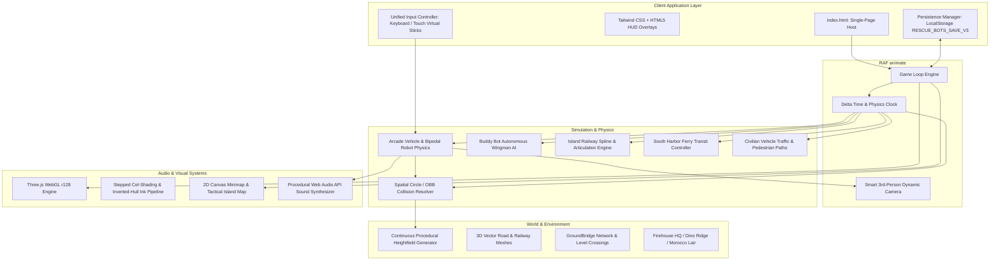
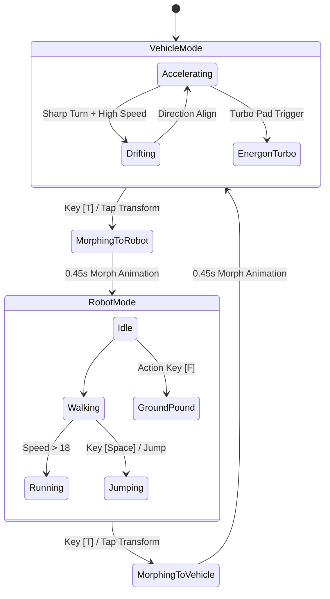
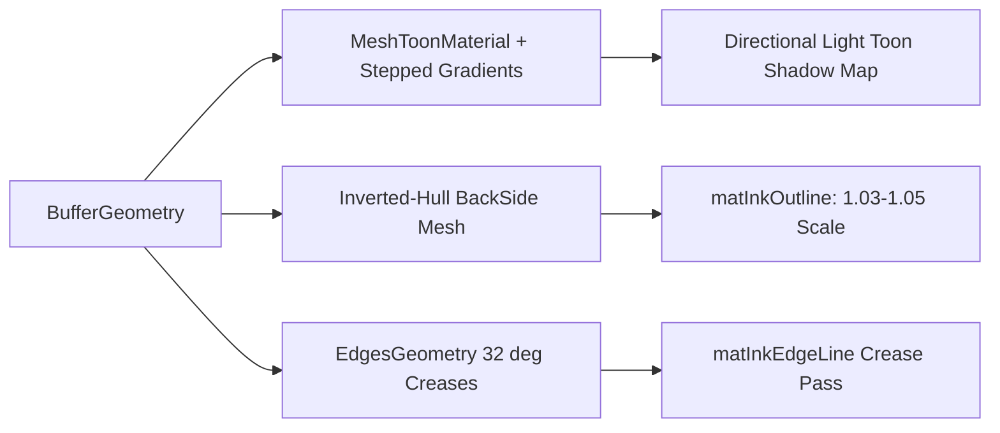

# Griffin Rock Rescue Bots: Game Architecture Overview

This document outlines the software architecture, rendering pipeline, world generation, vehicle physics, and gameplay systems of the **Transformers Rescue Bots: Griffin Rock Open World Adventure**.

---

## 1. High-Level Architecture Diagram

---

## 2. Core Architectural Principles

1. **Zero-Dependency Single-File Delivery**:
   * The complete runtime runs directly from [`index.html`](file:///Users/jackson/git/jacksonhardaker/rescue-bots-game/index.html) with external assets limited only to standard CDN libraries (Three.js r128, Tailwind CSS, Google Fredoka/Orbitron fonts).
   * Assets such as textures, sound effects, road markings, face decals, and hazard stripes are generated **100% procedurally in-memory via HTML5 Canvas and Web Audio API**, eliminating asset load latency and network 404s.

2. **Arcade-First Accessibility**:
   * Tuned specifically for responsive, responsive cartoon physics: high acceleration, snappy turns, generous drift recovery, ground snapping, and smooth slope alignment without vehicle roll-overs.
   * Multi-input support: seamless hot-swapping between desktop WASD/Arrow controls and mobile multi-touch virtual joysticks/buttons.

3. **Deterministic Procedural Island Geography**:
   * A continuous 4,950 × 4,950 coordinate space (~24.5M sq units) generated by pure mathematical functions (`getTerrainHeight`, `getRailwayRadius`, `getOuterRoadRadius`), ensuring instantaneous height lookups for rendering, rayless collision checks, and AI navigation.

---

## 3. Subsystem Breakdown

### 3.1 Procedural World & Terrain Engine
* **Terrain Heightfield (`getTerrainHeight`)**:
  * Employs multi-scale sinusoidal synthesis combined with distance-attenuated feature flattening for civic centers, sanctuaries, and plateaus.
  * Roadway and railway corridors are carved dynamically into the terrain using smooth polynomial step functions (`smoothstep`), providing flat roadbeds and sloped embankments that guarantee zero polygon clipping.
* **Vector Road Ribbon Generator (`createRoadRibbon`)**:
  * Constructs smooth 3D triangle ribbon meshes from arbitrary 2D waypoint splines.
  * Projects road edges perpendicular to tangent directions, applies longitudinal UV texture repeat intervals, and integrates small vertical offsets (`yLift`) and depth polygon offsets to eliminate Z-fighting.
* **Paved Apron Junction Network (`createRoadIntersectionPad`)**:
  * Circular and pill-shaped asphalt slabs smooth road junctions, building forecourts, turnouts, and level crossings.

---

### 3.2 Vehicle Physics & Transformation State Machine

* **Playable Rescue Bots**:
  * **Core Team**: Heatwave (Fire Engine), Chase (Police Cruiser), Blades (Rescue Copter), Boulder (Bulldozer / Dump Truck).
  * **Visiting Allies**: Optimus Prime (Semi-Cab), Bumblebee (Sports Car), Blurr (Race Car), Salvage (Recycling Rig), High Tide (Amphibious Sub/Boat), Quickshadow (Covert Spy Car).
* **Two Operating Forms**:
  * **Vehicle Form**: 4-wheel independent rotation, velocity-coupled suspension roll/pitch, slip angle drift calculation, and dynamic headlights.
  * **Robot Form**: Procedural hierarchical skeletal hierarchy (pelvis, torso, shoulders, arms, forearms, hips, knees, feet) animated via real-time sinusoidal inverse kinematics.
* **Autonomous Buddy Bot AI (`buddyBot`)**:
  * Wingman following logic maintaining formation on player's flank with dynamic lane keeping, collision avoidance, and catch-up boost mechanics.

---

### 3.3 Dynamic Transit & World Simulation

| System | Implementation | Features |
| :--- | :--- | :--- |
| **Griffin Rock Express** | Continuous distance spline (`ptsRailway`, ~4,500m loop) | 7-car articulated train, flanged wheels, animated side connecting rods, cartoon steam puffs, SAT-based bot impact physics. |
| **Level Crossings** | Highway / rail intersection triggers | Warning crossbucks, dual alternating red LED signals, bell acoustic synthesis, and automatic crossing gate barriers. |
| **South Harbor Ferry** | Timed bidirectional transit controller | Navigates between Harbor Quay and Wayward Pier; supports onboard bot parking with relative platform motion. |
| **GroundBridge Network** | 4 Doc Greene Teleportation Portals | Torus ring iris animations, vortex opacity pulsation, safe off-road roadside turnouts, and instant transit cooldowns. |
| **Civilian Traffic** | Loop spline waypoint pathing | Multi-class vehicles (Sedans, Pickups, Vans) with collision braking, night headlights, and horn reactions. |

---

### 3.4 Cartoon Toon Rendering Pipeline

* **Toon Ramp Lighting**: Custom 3-step, 4-step, and glossy 1D gradient maps (`toonGrad3`, `toonGrad4`, `toonGradGlossy`) give all models vibrant animated cel-shading.
* **Inverted-Hull Outline Pipeline (`applyCartoonInkOutlines`)**: Automatically duplicates meshes with slightly inflated inverted hull geometries (`THREE.BackSide`) and edge creases to produce comic-book ink borders without expensive post-processing passes.
* **Spatial Distance Culling (`registerCullableObject`)**: Lightweight radial distance evaluation automatically toggles mesh hierarchies on/off beyond draw distances.

---

### 3.5 Procedural Audio Synthesizer (`SoundEffects`)
* Built directly on the native browser **Web Audio API** (`AudioContext`).
* **Zero Audio Files Loaded**:
  * **Engine Audio**: Frequency-modulated triangle/sawtooth oscillators coupled to vehicle velocity and RPM.
  * **Locomotive Horn**: Real 5-chime chord harmonic synthesis (Eb4, F#4, G#4, B4, Eb5).
  * **Railroad Crossing Bells**: Dual-resonance chime oscillators (880Hz + 1760Hz harmonic).
  * **Siren & Rescue SFX**: Dual-tone wails, water cannon white-noise spray, transformation mechanical zips, GroundBridge warp wooshes, and MorBot laser blasts.

---

### 3.6 Dual Navigation Mapping System
1. **Interactive HUD Minimap**:
   * Corner-anchored dynamic 2D canvas showing island coastline, ring highway contours, railway circuit, active train position, player arrow, buddy bot blip, and emergency beacon markers.
   * Clicking the minimap opens the Tactical Map overlay.
2. **Full-Screen Tactical Island Map**:
   * Responsive high-resolution canvas overlay providing panoramic island situational awareness, clickable navigation waypoint routing, live landmark labels, and emergency radar rings.

---

## 4. Key Code Locations in `index.html`

* **Lines 1–1500**: DOM layout, Tailwind CSS styling, HUD dials, Virtual Joysticks, and Modal Overlays.
* **Lines 1500–2800**: Web Audio API Sound Synthesizer (`SoundEffects`).
* **Lines 2800–5150**: Toon materials, textures, character face decals, and procedural sprite generators.
* **Lines 5150–5850**: Island dimensions, heightfield generator (`getTerrainHeight`), and zone detector (`getZoneName`).
* **Lines 5850–6500**: Terrain mesh, 3D vector road ribbons (`createRoadRibbon`), and railway circuit loop.
* **Lines 6500–8900**: 3D Landmarks (Firehouse HQ, Robo-Wash, Turbo-Charger, GroundBridges, Dino Ridge, Morocco Lair).
* **Lines 8900–14500**: Playable bot 3D model builders and transformation rigs for all 10 Rescue Bots.
* **Lines 14500–17300**: Game state initialization, progression, player physics definitions, and controls handling.
* **Lines 17300–18450**: Civilian NPC traffic and pedestrian simulation.
* **Lines 18450–19500**: Griffin Rock Express Train system, car articulation, and smoke particle simulation.
* **Lines 19500–21900**: Emergency mission beacons, tool actions (firehose, bulldozer plow, winch), and MorBot boss battle.
* **Lines 21900–23200**: Minimap and full-screen Tactical Island Map canvas drawing engines.
* **Lines 23200–24500**: Main animation loop (`animate`), delta-time stepping, transformation transitions, and collision resolution.