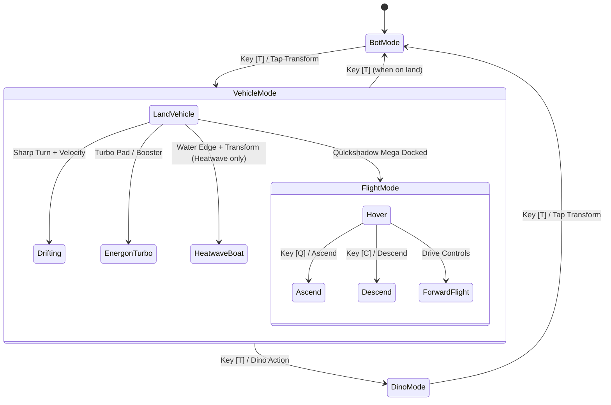
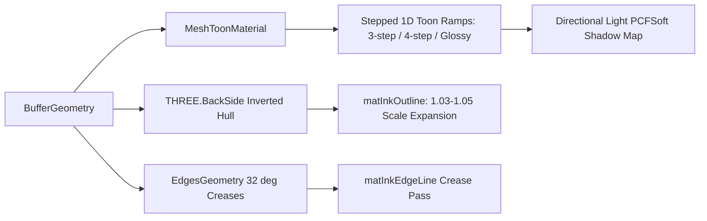

# Griffin Rock Rescue Bots: Game Architecture Overview

This document provides a comprehensive technical overview of the software architecture, rendering pipeline, procedural world generation, multi-form transformation mechanics, vehicle & flight physics, dynamic day/night weather hazards, and gameplay simulation systems of **Transformers Rescue Bots: Griffin Rock Open World Adventure**.

---

## 1. High-Level Architecture Diagram

```mermaid
graph TD
    subgraph Client Application Layer
        Host[docs/index.html: Self-Contained Host]
        UI[Tailwind CSS + HTML5 HUD Overlays]
        Icons[src/ui/icons.ts: SVG Vector Iconography Standard]
        Input[Unified Input Controller: Keyboard / Touch Joysticks]
        Storage[src/progression/progression.ts: LocalStorage V4 Store]
    end

    subgraph Core Game Loop [src/game/loop.ts]
        Loop[Game Loop Engine - RAF]
        Time[Delta Time & Physics Clock]
        Camera[Smart 3rd-Person Dynamic Chase / Flight Camera]
        Culling[src/game/culling.ts: Spatial Distance Culling]
    end

    subgraph Simulation & Physics
        PlayerPhys[src/physics/movement.ts: Vehicle, Robot & Flight Physics]
        WaterPhys[Amphibious Physics & Water Boundary Restrictions]
        BuddyAI[Buddy Bot Autonomous Wingman AI]
        TrainSim[src/world/railway.ts: Griffin Rock Express Circuit]
        NPCSim[src/world/npcs.ts: Civilian Traffic & Pedestrians]
        PropPhys[src/world/props.ts: Dynamic Physics Cones & Barriers]
        Hazards[src/world/weatherHazards.ts: Volcanic Debris & Slick Roads]
    end

    subgraph World & Environment
        Heightfield[src/world/terrain.ts: Procedural Continuous Heightfield]
        TerrainMesh[src/world/terrainMesh.ts: Chunked Ground Meshes]
        RoadRibbons[src/world/roads.ts: 3D Vector Road Ribbons & Bridges]
        RailNetwork[src/world/railway.ts: Spline Tracks & Level Crossings]
        POIs[src/world/buildings.ts: Firehouse HQ / Dino Ridge / Test Yard]
        Missions[src/world/emergencies.ts & morbot.ts: Missions & Boss Battle]
        WeatherSim[src/world/weather.ts: 24h Day/Night & Weather Simulation]
    end

    subgraph Bot Modeling & Rigging [src/bots/]
        BotRigs[src/bots/botRigs.ts & botMeta.ts]
        PlayableBots[10 Bot Modules: Boulder, Heatwave, Chase, Blades, etc.]
        DinoRigs[Dinobot Transformations: T-Rex, Stegosaur, Pterosaur, etc.]
        DockModes[Megabot Docking Rig & Powered Vehicle Enhancements]
    end

    subgraph Audio & Visual Systems
        Renderer[src/rendering/scene.ts: Three.js WebGL Engine]
        ToonPipeline[src/rendering/materials.ts: Cel-Shading & Inverted-Hull Ink]
        Textures[src/rendering/textures.ts: Procedural Canvas Sprites]
        Overlays[src/ui/tacticalMap.ts: 2D Minimap & Fullscreen Tactical Map]
        Audio[src/audio/soundFX.ts: Procedural Web Audio API Synthesizer]
    end

    Host --> Loop
    Input --> PlayerPhys
    Loop --> Time
    Time --> PlayerPhys
    Time --> WaterPhys
    Time --> BuddyAI
    Time --> TrainSim
    Time --> NPCSim
    Time --> PropPhys
    Time --> Hazards
    Time --> WeatherSim
    PlayerPhys --> Camera
    PlayerPhys --> Culling
    PlayerPhys --> BotRigs
    BotRigs --> PlayableBots
    PlayableBots --> DinoRigs
    PlayableBots --> DockModes
    Loop --> Renderer
    Loop --> Overlays
    PlayerPhys --> Audio
    Hazards --> Audio
    WeatherSim --> Renderer
    Storage <--> Loop
```



---

## 2. Core Architectural Principles

1. **Modular TypeScript Architecture with Single-File Bundling**:
   * The codebase is written in modern, strongly-typed **TypeScript** across modular domain packages in [`src/`](file:///Users/jackson/git/jacksonhardaker/rescue-bots-game/src).
   * **Vite** paired with `vite-plugin-singlefile` compiles and inlines the entire application, shaders, SVGs, and procedural generators into a single standalone production build at [`docs/index.html`](file:///Users/jackson/git/jacksonhardaker/rescue-bots-game/docs/index.html) for zero-dependency GitHub Pages hosting.
   * Full Hot-Module Replacement (HMR) and strict typechecking (`tsc --noEmit`) ensure rapid, error-free iteration.

2. **Zero External Assets (100% Procedural Generation)**:
   * **Audio**: Synthesized in real-time via the browser's native **Web Audio API** (`AudioContext`). No audio files (.mp3, .wav) are downloaded.
   * **Textures & Decals**: Procedural Canvas-generated character faces, tire treads, hazard chevrons, crests, and road markings.
   * **Vector Iconography**: Custom SVG vector artwork defined in [`src/ui/icons.ts`](file:///Users/jackson/git/jacksonhardaker/rescue-bots-game/src/ui/icons.ts) adhering to strict project standards ([`AGENTS.md`](file:///Users/jackson/git/jacksonhardaker/rescue-bots-game/AGENTS.md)) to avoid inconsistent emoji rendering across platforms.

3. **Arcade-First Cartoon Physics**:
   * Tailored for high responsiveness: immediate acceleration, snappy steering, drift recovery, ground slope alignment, vertical jump jets, and terrain surface clamping.
   * Universal input layer supporting desktop keyboard/mouse and mobile multi-touch virtual joysticks seamlessly.

4. **Deterministic Procedural Island Geography**:
   * Continuous coordinate space (~5,000 × 5,000 units, ~25M sq units) driven by pure mathematical functions (`getTerrainHeight`, `getWaterDepth`, `getOuterRoadRadius`), enabling instant, raycast-free elevation lookups for physics, AI pathing, and rendering.

---

## 3. Subsystem Breakdown

### 3.1 Modular Codebase Organization

The source code in [`src/`](file:///Users/jackson/git/jacksonhardaker/rescue-bots-game/src) is partitioned into clear technical domains:

| Directory | Responsibilities | Key Files |
| :--- | :--- | :--- |
| **`src/`** | Application bootstrap & module coordination | [`main.ts`](file:///Users/jackson/git/jacksonhardaker/rescue-bots-game/src/main.ts) |
| **`src/rendering/`** | Three.js scene, camera, lights, materials & ink outline pipeline | [`scene.ts`](file:///Users/jackson/git/jacksonhardaker/rescue-bots-game/src/rendering/scene.ts), [`materials.ts`](file:///Users/jackson/git/jacksonhardaker/rescue-bots-game/src/rendering/materials.ts), [`textures.ts`](file:///Users/jackson/git/jacksonhardaker/rescue-bots-game/src/rendering/textures.ts) |
| **`src/physics/`** | Vehicle dynamics, robot locomotion, flight, water boundaries & player state | [`movement.ts`](file:///Users/jackson/git/jacksonhardaker/rescue-bots-game/src/physics/movement.ts), [`player.ts`](file:///Users/jackson/git/jacksonhardaker/rescue-bots-game/src/physics/player.ts) |
| **`src/bots/`** | 3D models, procedural geometries, transformation rigs & bot metadata | [`botMeta.ts`](file:///Users/jackson/git/jacksonhardaker/rescue-bots-game/src/bots/botMeta.ts), [`botRigs.ts`](file:///Users/jackson/git/jacksonhardaker/rescue-bots-game/src/bots/botRigs.ts), individual bot files (`heatwave.ts`, `blades.ts`, etc.) |
| **`src/world/`** | Procedural terrain, roads, railway, buildings, NPCs, emergencies, weather & hazards | [`terrain.ts`](file:///Users/jackson/git/jacksonhardaker/rescue-bots-game/src/world/terrain.ts), [`roads.ts`](file:///Users/jackson/git/jacksonhardaker/rescue-bots-game/src/world/roads.ts), [`railway.ts`](file:///Users/jackson/git/jacksonhardaker/rescue-bots-game/src/world/railway.ts), [`weather.ts`](file:///Users/jackson/git/jacksonhardaker/rescue-bots-game/src/world/weather.ts), [`weatherHazards.ts`](file:///Users/jackson/git/jacksonhardaker/rescue-bots-game/src/world/weatherHazards.ts) |
| **`src/game/`** | Main loop step, delta-time management, input orchestration & distance culling | [`loop.ts`](file:///Users/jackson/git/jacksonhardaker/rescue-bots-game/src/game/loop.ts), [`culling.ts`](file:///Users/jackson/git/jacksonhardaker/rescue-bots-game/src/game/culling.ts) |
| **`src/audio/`** | Procedural Web Audio API sound synthesis | [`soundFX.ts`](file:///Users/jackson/git/jacksonhardaker/rescue-bots-game/src/audio/soundFX.ts) |
| **`src/ui/`** | Responsive HUD overlays, custom vector icons, minimap, tactical map & settings modal | [`hud.ts`](file:///Users/jackson/git/jacksonhardaker/rescue-bots-game/src/ui/hud.ts), [`icons.ts`](file:///Users/jackson/git/jacksonhardaker/rescue-bots-game/src/ui/icons.ts), [`tacticalMap.ts`](file:///Users/jackson/git/jacksonhardaker/rescue-bots-game/src/ui/tacticalMap.ts), [`settingsModal.ts`](file:///Users/jackson/git/jacksonhardaker/rescue-bots-game/src/ui/settingsModal.ts) |
| **`src/progression/`** | LocalStorage persistence, rank progression, unlocked allies, badges & statistics | [`progression.ts`](file:///Users/jackson/git/jacksonhardaker/rescue-bots-game/src/progression/progression.ts) |
| **`src/botcheck/`** | Visual bot inspection and validation harness | [`visualCheck.ts`](file:///Users/jackson/git/jacksonhardaker/rescue-bots-game/src/botcheck/visualCheck.ts) |

---

### 3.2 Bot Roster & Transformation State Machine



* **Playable Rescue Bots & Modes**:
  1. **Heatwave**: Fire Engine / Brachiosaur / **Catamaran Rescue Boat** / Megabot Water Cannon Tower.
  2. **Boulder**: Bulldozer / Dump Truck / Triceratops / Megabot Excavator.
  3. **Chase**: Police Interceptor / Stegosaurus / Megabot Radar Tower.
  4. **Blades**: Rescue Helicopter / Pterosaur (Flight Physics) / Megabot Sky Lifter.
  5. **Optimus Prime**: Heavy Semi-Truck Cab / T-Rex (Titan Scale) / Megabot Command Base.
  6. **Bumblebee**: Sports Racer / Velociraptor / Megabot Turbo Booster.
  7. **Blurr**: Supersonic Speedster / Gallimimus / Megabot Warp-Drive.
  8. **Salvage**: Recycling Compactor Rig / Ankylosaurus / Megabot Wrecking Crane.
  9. **High Tide**: Armored Amphibious Submarine / Plesiosaur / Megabot Heavy Battleship.
  10. **Quickshadow**: Covert Luxury Coupe / Dilophosaurus / **Megabot Flight Interceptor**.

* **Water Movement Restrictions & Amphibious Transitions**:
  * Water surface level is set at `y = 0`.
  * **Strict Water Authorization**: Only **Heatwave Boat Mode**, **High Tide (Vehicle & Dino Modes)**, and **Mega High Tide** are permitted to enter and navigate ocean water.
  * All other bots and land vehicles are prevented from crossing into the ocean by the shoreline barrier physics in [`src/physics/movement.ts`](file:///Users/jackson/git/jacksonhardaker/rescue-bots-game/src/physics/movement.ts).
  * **Context-Aware Transformation**: When Heatwave is in Fire Engine mode on land and transforms, he transitions directly to Dino mode. When at the water's edge, transforming automatically switches him into Catamaran Rescue Boat mode.

* **Megabot Docking Station**:
  * Located at Firehouse HQ apparatus bays. Driving onto the dock pad triggers the Megabot docking sequence, augmenting the bot with enhanced chassis armor, mega-mode utilities, and unique abilities (such as Quickshadow's vehicle flight mode).

---

### 3.3 Dynamic Day/Night Cycle & Weather Hazards

Griffin Rock features a dynamic 24-hour diurnal lighting system with procedural environmental weather shifts simulated in [`src/world/weather.ts`](file:///Users/jackson/git/jacksonhardaker/rescue-bots-game/src/world/weather.ts) and [`src/world/weatherHazards.ts`](file:///Users/jackson/git/jacksonhardaker/rescue-bots-game/src/world/weatherHazards.ts):

| Weather Mode | Sky & Fog Palette | Sun & Lighting | Special Visuals & Hazards |
| :--- | :--- | :--- | :--- |
| **Sunny Day** | `0x5ec5ff` Sky Blue | Warm White (`0xfff7e6`, 1.25x) | Optimum visibility, clear roads, active civilian traffic. |
| **Golden Sunset** | `0xfce7b3` Champagne Gold | Warm Ivory (`0xfffbeb`, 1.18x) | Gentle golden hour atmosphere, long low-angle shadows, headlights turn on. |
| **Summer Rainstorm** | `0x334155` Slate Storm | Dim Cool Gray (`0x94a3b8`, 0.55x) | Dynamic rain particle field, thunder rumbles, surging ocean waves, slick wet roads reducing tire grip. |
| **Coastal Sea Fog** | `0x64748b` Fog Slate | Muted Light (`0x94a3b8`, 0.65x) | Heavy exponential fog (`0.0028` density), periodic foghorn audio cues, reduced sightlines. |
| **Volcanic Debris** | `0x1e1b4b` Deep Indigo | Ash Orange (`0xf97316`, 0.85x) | Volcanic ember particles, smoke plumes, **molten basalt rocks** ejected onto highways that the player cools with Heatwave's water cannon for **+5 Hero Points**. |
| **Starry Night Ops** | `0x090d16` Cosmic Midnight | Moonlit Navy (`0x38bdf8`, 0.35x) | Rotating starfield, Aurora Borealis mesh, glowing streetlamp fixtures, full high-beam headlights. |

* **Time-of-Day Progression**:
  * Continuous 24-hour clock (`timeOfDay` 0.0–24.0) with an auto-cycle toggle (Key [T] or HUD button) and manual weather lock mode.
  * Streetlamps and civilian NPC vehicle headlights automatically illuminate when dusk falls (`timeOfDay >= 18.0` or night ops active).

---

### 3.4 Cartoon Toon Rendering Pipeline



* **Stepped Cel-Shading**:
  * Implemented using Three.js `MeshToonMaterial` paired with procedural 1D gradient ramps generated via HTML5 Canvas in [`src/rendering/materials.ts`](file:///Users/jackson/git/jacksonhardaker/rescue-bots-game/src/rendering/materials.ts).
* **Inverted-Hull Ink Outline Pass**:
  * Meshes receive comic-book style dark outlines via slightly inflated duplicate hulls rendered with `THREE.BackSide` along with crease edge overlays. This eliminates the performance cost of screen-space post-processing shaders while providing consistent ink lines across mobile and desktop.
* **Spatial Distance Culling**:
  * [`src/game/culling.ts`](file:///Users/jackson/git/jacksonhardaker/rescue-bots-game/src/game/culling.ts) evaluates radial distance to the active camera and automatically toggles rendering hierarchies off for objects beyond their draw radius.

---

### 3.5 Procedural Audio Synthesizer

Synthesized entirely via the **Web Audio API** in [`src/audio/soundFX.ts`](file:///Users/jackson/git/jacksonhardaker/rescue-bots-game/src/audio/soundFX.ts):
* **Vehicle Engines**: FM synthesis using triangle/sawtooth oscillators with frequency modulated by wheel velocity, acceleration, and gear shifts.
* **Emergency Sirens**: Multi-tone wails and yelps with frequency sweep modulation.
* **Locomotive Horn**: Multi-chime chord harmonic synthesis (Eb4, F#4, G#4, B4, Eb5) for the Griffin Rock Express.
* **Railroad Crossing Bells**: Dual-resonance chime oscillators (880Hz + 1760Hz harmonic).
* **Environmental SFX**: White noise water cannon spray, low-frequency thunder rumbles, coastal foghorns, and volcanic rumble sweeps.
* **Transformation SFX**: Multi-stage mechanical servos, ratchet clicks, and energon whooshes.

---

### 3.6 Navigation & HUD Architecture

1. **Custom SVG Vector Iconography**:
   * All iconography across the HUD, bot selector, megabot dock, action buttons, tactical map, and modal dialogs uses crisp vector SVGs from [`src/ui/icons.ts`](file:///Users/jackson/git/jacksonhardaker/rescue-bots-game/src/ui/icons.ts), strictly prohibiting emoji strings as mandated by [`AGENTS.md`](file:///Users/jackson/git/jacksonhardaker/rescue-bots-game/AGENTS.md).
2. **Interactive HUD Minimap**:
   * Top-left corner circular radar displaying island contours, highway corridors, railway circuit, live train blip, player position arrow, buddy bot marker, and active emergency beacons.
3. **Full-Screen Tactical Island Map**:
   * Canvas-rendered panoramic island map showing full topography, landmark pins, GroundBridge teleporters, and clickable autopilot waypoints.

---

### 3.7 Progression & State Persistence

* Handled by [`src/progression/progression.ts`](file:///Users/jackson/git/jacksonhardaker/rescue-bots-game/src/progression/progression.ts) using a **V4 LocalStorage Schema** (`rescue_bots_save_v4`).
* Automatically migrates legacy saves from V1–V3 formats while maintaining backward compatibility.
* Tracks:
  * Total emergencies resolved, citizens rescued, energon cubes collected, and stunts completed.
  * Hero Point progression and rank titles (Cadet Bot up to Supreme Rescue Commander).
  * Discovered landmarks (17 points of interest), collected crests, and unlocked ally bots.
  * Player bot selections, buddy wingman partner, and current weather mode.

---

## 4. Key Source Code Directory Index

```text
rescue-bots-game/
├── docs/                      # Production build destination for GitHub Pages
│   ├── index.html             # Inlined standalone single-file bundle
│   └── game-architecture.md   # This architecture documentation
├── src/                       # TypeScript modular source code
│   ├── main.ts                # App initialization & bootstrapping
│   ├── audio/                 # Web Audio API procedural synthesis
│   │   └── soundFX.ts
│   ├── botcheck/              # Visual Bot Check inspector tool
│   │   └── visualCheck.ts
│   ├── bots/                  # Bot 3D models, rigs & transformations
│   │   ├── botMeta.ts         # Roster metadata, speed, agility & colors
│   │   ├── botRigs.ts         # Generic articulation rigs
│   │   ├── botHelpers.ts      # Shared mesh builder utilities
│   │   └── [botName].ts       # Individual bot models (Boulder, Heatwave, etc.)
│   ├── game/                  # Main loop & engine services
│   │   ├── loop.ts            # Animation loop & physics tick
│   │   └── culling.ts         # Distance culling optimizer
│   ├── physics/               # Movement, flight, water & player state
│   │   ├── movement.ts        # Vehicle, bipedal & water physics
│   │   └── player.ts          # Player state machine & controls
│   ├── progression/           # Persistence, ranks, badges & stats
│   │   └── progression.ts
│   ├── rendering/             # Three.js scene, toon materials & textures
│   │   ├── scene.ts           # Scene, camera, sunlight & hemiLight
│   │   ├── materials.ts       # Toon shaders & inverted-hull ink pipeline
│   │   └── textures.ts        # Procedural canvas textures & decals
│   ├── settings/              # User settings & controls configuration
│   │   └── settings.ts
│   ├── state/                 # Global runtime game state store
│   │   └── gameState.ts
│   ├── ui/                    # UI overlay, HUD, map, dialogs & icons
│   │   ├── hud.ts             # On-screen buttons, dials & joysticks
│   │   ├── icons.ts           # Custom SVG icon repository (SVG_ICONS)
│   │   ├── tacticalMap.ts     # Minimap & full-screen tactical map
│   │   ├── settingsModal.ts   # Settings dialog & keybindings
│   │   └── dialogs.ts         # Toast banners & catchphrase dialogs
│   └── world/                 # Island generation, props, railway & weather
│       ├── terrain.ts         # Procedural heightfield formulas
│       ├── terrainMesh.ts     # Terrain buffer geometry chunks
│       ├── roads.ts           # 3D road ribbons & bridges
│       ├── railway.ts         # Express train & level crossing system
│       ├── buildings.ts       # Firehouse HQ, landmarks & structures
│       ├── props.ts           # Interactive traffic cones & crash barriers
│       ├── vegetation.ts      # Pine trees, palm trees & foliage
│       ├── npcs.ts            # Civilian road traffic & pedestrians
│       ├── collectibles.ts    # Energon cubes, crests & relics
│       ├── emergencies.ts     # Active rescue incident scenarios
│       ├── morbot.ts          # Dr. Morocco MorBot drone boss encounter
│       ├── allies.ts          # Unlockable ally bots stationed on island
│       ├── weather.ts         # 24h Day/night & dynamic weather modes
│       └── weatherHazards.ts  # Volcanic debris, slick roads & storm waves
├── AGENTS.md                  # Development guidelines & SVG icon standard
├── README.md                  # Project overview, disclaimer & controls guide
├── package.json               # NPM package configuration & scripts
└── vite.config.js             # Vite single-file bundler configuration
```
