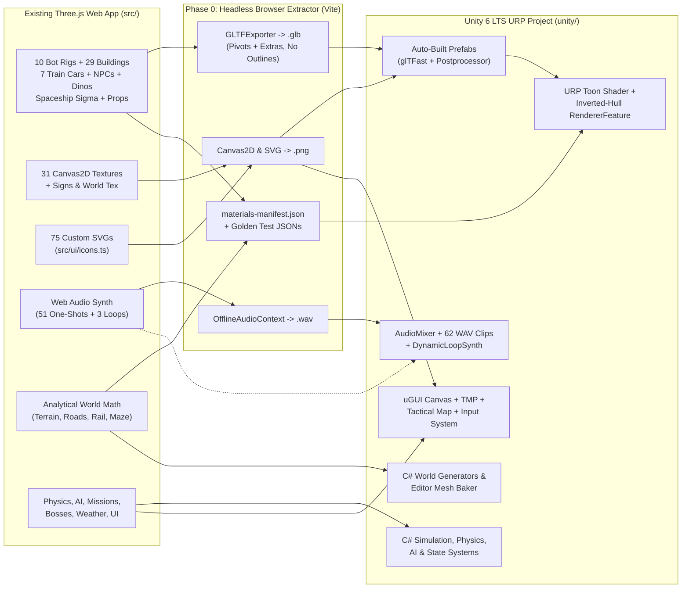

# Unity 6 LTS Conversion Plan: Griffin Rock Rescue Bots 3D

## 1. Executive Summary & Architecture

This document outlines the engineering plan to convert **Transformers Rescue Bots: Griffin Rock Open World Adventure** (~44,373 lines of TypeScript/Three.js + HTML/Tailwind) into a native **Unity 6 LTS (6000.0 LTS, Universal Render Pipeline)** project located entirely in the nested `unity/` directory of this repository.

The project targets:
- **iOS / iPadOS (Touch / Tablet)**
- **macOS / Windows (Desktop)**

All assets, systems, and source code will be contained within:
```text
rescue-bots-game/
├── unity/                         # Root of Unity 6 LTS Project
│   ├── Assets/
│   │   ├── Art/                   # Models (.glb), Textures (.png), Shaders, UI Icons
│   │   ├── Audio/                 # AudioMixer, baked .wav SFX
│   │   ├── Data/                  # ScriptableObjects for Bots, Missions, Landmarks
│   │   ├── Prefabs/               # Auto-configured Bot and World Prefabs
│   │   ├── Scenes/                # BootScene, SurfaceScene, UndergroundScene, QA Studios
│   │   ├── Scripts/               # Core, Rendering, World, Bots, Physics, Gameplay, Audio, UI
│   │   └── Tests/                 # EditMode and PlayMode Parity Tests
│   ├── Packages/
│   ├── ProjectSettings/
│   └── PLAN.md                    # This Conversion Plan
```

### Architecture Pipeline



---

## 2. Audited Source Bugs Fixed During Conversion

The following 8 confirmed source defects from the web game will be resolved cleanly during the port:

| # | Current Source File | Confirmed Bug / Quirk | Unity Port Fix |
| :-: | :--- | :--- | :--- |
| 1 | `src/ui/dialogs.ts:108-148` | Queries non-existent `#speech-bubble` DOM IDs and calls missing `sfx.playNPCSpeech()`, dropping NPC/bot dialogue bubbles. | Wire `SpeechBubbleController` directly to the uGUI world-space comic bubble (`#npc-world-bubble` design) and play `playSpeechPop`. |
| 2 | `src/world/terrain.ts:224-225` | Shadowed empty local `ramps = []` and `ferryController = null` prevent `getSurfaceHeight()` from returning ramp inclines or moving ferry deck heights. | Inject live `StuntRamp[]` and `HarborFerryController` into `TerrainMath.GetSurfaceHeight()`. |
| 3 | `src/physics/movement.ts:570-593` | `inBoatMode` does not exclude `HIGHTIDE`, reducing High Tide's submarine water speed from `62/82` to the generic `48/64`. | Route `BotId.HighTide` in water directly to `62 m/s` (`82 m/s` boosted). |
| 4 | `src/physics/movement.ts:909-911` | Airborne flight banking reads `input.left` / `input.right`, which are never set by input listeners. | Drive airborne roll banking directly from unified `moveInput.x` (`±0.32 rad`). |
| 5 | `src/physics/player.ts:1074` | `triggerTransform()` skips High Tide to `DINO` on land, which is then blocked by `setPlayerMode()`'s `!isNearWater(22)` guard despite High Tide Dino being amphibious. | Gate `IsNearWater` only on High Tide `VEHICLE` (Submarine), allowing `BOT ↔ DINO` freely on dry land. |
| 6 | `src/bots/optimus.ts:82` | `fifthWheel.userData.isStandardOnlyPart = true` mismatches `setOptimusRigMega`'s check for `isStandardPart`. | Normalize tag to `isStandardPart = true` during Phase 0 export. |
| 7 | `src/world/morbot.ts:604` & `src/world/dumpsters.ts:229` | Write rewards to `energonCubesCollected` (+75) and `energonCollected` (+15), while `progression.ts` persists `totalEnergonCubes`. | Route all Energon awards through a single `ProgressionService.AddEnergon(int)` API. |
| 8 | `src/rendering/textures.ts`, `src/game/loop.ts`, `src/ui/tacticalMap.ts` | Salvage's chest uses OS font glyph `♻`; toasts and tactical map landmarks contain Unicode emojis (`🏛️`, `🦖`, `🚀`, `🧼`, etc.). | Draw Salvage's recycling symbol via pure vector paths; replace all UI/map emojis with custom vector sprites from `src/ui/icons.ts` (enforcing AGENTS.md). |

---

## 3. Mathematical Coordinate & Handedness Contract

Three.js is **Right-Handed Y-Up** (`+X` East, `+Y` Up, `-Z` North, `+Z` South, `heading = 0` facing `+Z`). Unity is **Left-Handed Y-Up** (`+X` East, `+Y` Up, `+Z` North, `yaw = 0` facing `+Z`). Unity's `glTFast` importer mirrors X on imported models (`x -> -x`), preserving their local `+Z` forward axis.

Using **Z-negation for World Space** + **X-mirror for glTFast Rig Local Space**:
- Preserves standard compass directions: `+Z` = North (Up on maps), `+X` = East (Right on maps).
- Allows all local morph formulas in `botRigs.ts` and `botBoats.ts` to be ported mechanically without manual sign hunting.

```csharp
// unity/Assets/Scripts/Core/CoordConvert.cs
namespace RescueBots.Core
{
    public static class CoordConvert
    {
        // World Space: Three.js (x, y, z) -> Unity (x, y, -z)
        public static Vector3 ThreeWorldToUnity(float x, float y, float z) => new Vector3(x, y, -z);
        public static Vector3 UnityToThreeWorld(Vector3 u) => new Vector3(u.x, u.y, -u.z);

        // Heading: Three.js heading=0 faces +Z (South); Unity yaw=0 faces +Z (North) -> yaw = PI - heading
        public static float ThreeHeadingToUnityYawRad(float h) => Mathf.PI - h;
        public static float ThreeHeadingToUnityYawDeg(float h) => (Mathf.PI - h) * Mathf.Rad2Deg;
        public static Vector3 ForwardFromThreeHeading(float h) => new Vector3(Mathf.Sin(h), 0f, -Mathf.Cos(h));

        // glTFast Local Rig Space (X-mirrored on import, local nose remains +Z):
        public static Vector3 ThreeRigLocalPos(float x, float y, float z) => new Vector3(-x, y, z);

        public static Quaternion ThreeRigLocalEulerXYZ(float rxRad, float ryRad, float rzRad)
        {
            Quaternion qx = Quaternion.AngleAxis(rxRad * Mathf.Rad2Deg, Vector3.right);
            Quaternion qy = Quaternion.AngleAxis(ryRad * Mathf.Rad2Deg, Vector3.up);
            Quaternion qz = Quaternion.AngleAxis(rzRad * Mathf.Rad2Deg, Vector3.forward);
            Quaternion qRh = qx * qy * qz;
            return new Quaternion(qRh.x, -qRh.y, -qRh.z, qRh.w);
        }
    }
}
```

---

## 4. Subsystem Mapping Specifications

| Domain | Three.js Web Game | Unity 6 LTS (URP) Implementation |
| :--- | :--- | :--- |
| **Toon Shading** | `MeshToonMaterial` + 1D canvas ramps (`toonGrad3/4/Glossy`) | `RescueBotsToon.shader` sampling 1D `Point`-filtered LUT + shadow attenuation + GPU Instancing + Vertex Colors + Polygon Offset |
| **Ink Outlines** | `applyCartoonInkOutlines()` (+3,142 extra bot child meshes + `EdgesGeometry`) | URP RenderGraph `CartoonOutlineRendererFeature` (inverted-hull `Cull Front` pass filtered by `RenderingLayerMask` + optional crease edge pass; toggleable in Settings) |
| **3D Models** | 10 bots (1,779 base meshes), 29 buildings, 7 train cars, 10 Mega props, 3 MorBots, Blimp, Sigma-17, NPCs, Dinos, Props | Exported once via `GLTFExporter` (`.glb`) → imported via `com.unity.cloud.gltfast` → auto-configured Editor Postprocessor Prefabs with typed `*RigRefs` |
| **Textures** | 31 static Canvas2D textures (`textures.ts`) + signs + Sigma + cavern strata + 4096² terrain | Lossless `.png` imports (ASTC on iOS, BC7 on Desktop); 4096² terrain texture baked in Editor; MorBot overhead HP bar converted to World-Space uGUI |
| **Terrain & Foliage** | Single `360×360` mesh (130k verts) + 16 vegetation sectors (`InstancedMesh`) | `TerrainMath.cs` + Editor Baker generating **16 chunked `90×90` meshes** (16-bit indices, frustum culled) + `VegetationManager` (`Graphics.RenderMeshInstanced`) |
| **Physics** | Arcade kinematics, 5-point sampling, `48m` spatial hash, 2D OBB SAT, trailer ODE | Direct C# port (`PlayerMotor`, `SpatialHashGrid`, `OBB2D`) preserving exact arcade responsiveness without `WheelCollider` bounce regressions |
| **Underground** | Separate `undergroundScene` swapped in `animate()` | Additive `UndergroundScene.unity` toggled via root GameObjects for hitch-free drill transitions |
| **Audio** | 1,654-line Web Audio synth (51 one-shots + 3 continuous loops) | `AudioMixer` (`Master/SFX/Engine`) + 62 baked `.wav` clips (`OfflineAudioContext`) + `DynamicLoopSynth.cs` (`OnAudioFilterRead` DSP for engines, rotor chop, sirens) |
| **UI & Input** | Tailwind HTML + 75 SVGs + 2D Canvas maps + DOM keyboard/touch | uGUI (`ScaleWithScreenSize` + iOS SafeArea), TMP, 75-icon `SpriteAtlas`, baked map + pooled uGUI markers, Unity Input System (14 rebindable actions + touch tap/drag) |
| **Persistence** | `localStorage` (`rescue_bots_save_v4`, `rescue_bots_settings_v1`) | JSON files in `Application.persistentDataPath` schema-compatible with web V1–V4 saves (including web `.json` save import/export) |

---

## 5. Phased Implementation Roadmap

### Phase 0: Automated Headless Asset & Audio Extractor (Root Repo)
Run Vite in headless Chromium (`pnpm run export:unity`) with real browser DOM, Canvas2D, `GLTFExporter`, and `OfflineAudioContext`:
1. **Export `.glb` Models (`unity/Assets/Art/Models/`)**:
   - `Bots/` (10 bot rigs with named pivots and glTF `extras` for `isStandardPart`, `isMegaPart`, `isBoatPart`, `noOutline`).
   - `Buildings/` (29 models from `buildingModels.ts`).
   - `Railway/` (7 train cars + crossing + station).
   - `Allies/` (Servo + 10 Mega attachments).
   - `Villains/` (3 MorBots + Morocco Blimp + Escape Rocket).
   - `Cavern/` (Spaceship Sigma-17 + 5 shrines + 5 dinos).
   - `NPCs/` (Human rig + 4 civilian vehicles).
   - `Props/` (All props, 5 tree archetypes, bush, island rock).
2. **Export Textures & Materials (`unity/Assets/Art/Textures/` + `materials-manifest.json`)**:
   - 31 Canvas2D textures (with vector-drawn Salvage `♻`), 7 building signs, 3 Sigma-17 textures, 3 cavern strata/floor/cracked textures, road/rail tile textures, aurora ribbon, and material classification manifest.
3. **Export UI Icons (`unity/Assets/Art/UI/Icons/`)**:
   - Rasterize all **75 SVGs** from `src/ui/icons.ts` + Dr. Morocco's portrait SVG to 256×256 transparent PNGs (+ raw `.svg` backups).
4. **Bake Audio One-Shots (`unity/Assets/Audio/SFX/`)**:
   - Render all 51 one-shot methods via `OfflineAudioContext` (44.1 kHz, 16-bit PCM WAV), expanding variants to **62 `.wav` files**.
5. **Export Golden Parity Fixtures (`unity/Assets/Tests/Fixtures/`)**:
   - `terrain-golden.json` (1,000 coordinates verifying terrain height, surface height, water, road, and zone ground truth).
   - `underground-maze-golden.json` (13×13 maze adjacency, 8 chambers, 7 cracked walls, 16 dino spawns).

---

### Phase 1: Unity 6 Project Bootstrap, URP Toon Pipeline & QA Studios
- Create Unity 6 LTS project in `unity/` with URP, `glTFast`, Input System, TextMeshPro, and Test Framework.
- Establish assembly definitions: `RescueBots.Core`, `RescueBots.Rendering`, `RescueBots.World`, `RescueBots.Bots`, `RescueBots.Physics`, `RescueBots.Gameplay`, `RescueBots.Audio`, `RescueBots.UI`, `RescueBots.Editor`.
- Implement `RescueBotsToon.shader`, `RescueBotsUnlit.shader`, `OceanSwell.shader`, and `CartoonOutlineRendererFeature.cs` (RenderGraph inverted-hull outline pass).
- Implement `RescueBotsGltfPostprocessor.cs` to auto-map materials, assign `RenderingLayerMask`, and attach `BotRigRefs` to generated Prefabs.
- Create `BotCheckStudio.unity` and `ModelCheckStudio.unity` to visually validate all 20 bot forms and 70+ models against `docs/botcheck.html` / `docs/modelcheck.html`.

---

### Phase 2: Surface Island World, Roads, Railway & GPU-Instanced Vegetation
- Implement `TerrainMath.cs` (exact analytic heightfield, polar loops, mountain peaks, plateaus, road/rail carving, water/shoreline queries, 29 zones, and Bug #2 fix).
- Implement `IslandWorldBaker.cs` (Editor Tool) to generate:
  - **4×4 = 16 Chunked Terrain Meshes** (`90×90` quads each, seamless analytical normals, 16-bit indices) + baked **4096×4096** biome/plaza/road texture.
  - **8 Road Ribbons**, **20 Intersection Apron Pads**, and **960-segment Railway Ribbon** (CW winding, polygon offset).
  - Ocean plane (`y = -0.45`) with storm swell + pulsing `shorelineFoamRing` (`y = -0.25`).
- Implement `RailwaySystem.cs` (540-sample arc-length spline LUT, 7-car Griffin Rock Express, 4 grade crossings, train roof riding).
- Implement `VegetationManager.cs` (1,800 trees, 1,100 bushes, 520 rocks across 16 sectors via `Graphics.RenderMeshInstanced`; real-time Boulder scoop demolition and Heatwave water-cannon 5× growth).

---

### Phase 3: All 10 Playable Bots, 4-Mode Morphs, Mega Docking & Arcade Physics
- Implement `BotMetadataSO.cs` (20 ScriptableObjects storing speeds, ground offsets, scales, masses, OBB extents, parking slots, Mega locations, action labels, and 236 catchphrases).
- Implement `BotRigAnimator.cs` (interpolating `morph`, `dinoMorph`, `boatMorph` at `1.05/s`, Mega scale lerp, walk/smash/scoop/drill animations, wheels, rotors, cranes, loader arms, articulated trailer hitch).
- Implement `PlayerMotor.cs`, `SpatialHashGrid.cs`, and `OBB2D.cs` (6 locomotion modes, 5-point suspension sampling, ramp launches, gravity `44 m/s²`, trailer ODE, zero-GC spatial hash colliders, 4-axis OBB SAT traffic/train collisions; fixes Bugs #3 & #4).
- Implement `PlayerAbilityController.cs` (all 10 bots × 4 modes + Mega powers, Salvage dumpster override, kid-friendly auto-rescue, Jump/Sonar/Ascend/Descend, Siren, Boulder drill, Buddy cycling, Mega docking; fixes Bug #5).
- Implement `ChaseCameraController.cs` (front intro → rear auto-orbit, 3 zoom presets, floor clearance guard, underground 8-step ray clamp, analytical ray-heightfield tap-to-move / 20 Hz hold-and-drag autopilot).

---

### Phase 4: Interactive Landmarks, Living World, Emergencies, MorBot Boss & Weather
- Implement `InteractiveStationsManager.cs` & `HarborFerryController.cs`:
  - Robo-Wash (`5s` 1.25× Turbo Glaze), HQ Super Catapult, Drive-Thru Diner, Energon Turbo-Charger (`10s` rainbow boost), 4 cyclic GroundBridge Portals, 5-state Magnetic Gantry Crane, Rideable South Harbor Ferry (`28.6s` cruise + rigid deck containment), Anti-Grav Testing Yard (50m Bounce Pad, Speed Strip, 4 Splat Targets), 6 Stunt Ramps, 6 Stunt Hoops, 12 Salvage Dumpsters (hopper dump + 45s refill; fixes Bug #7), 26 ballistic props, 28 streetlamps, Ferris Wheel, Dino Ridge Baby Dinos.
- Implement `LivingWorldNPCManager.cs` & `BuddyBotAI.cs`:
  - 24 Human Citizens (patrol, wave, dynamic emergency reports), 28 Civilian Traffic Vehicles (OBB collisions, crossing yields, night headlights), 6 Visiting Autobots + Servo, and autonomous Buddy Bot wingman AI.
- Implement `EmergencyMissionManager.cs` & `CollectiblesAndLandmarks.cs`:
  - 8 Island Emergencies (`FIRE`, `ROCKSLIDE`, `SKY_RESCUE`, `TEAMUP`) × 6 hazard nodes + 2 stranded citizens + endless 65s auto-respawn, 4 Emergent Rescues, 32 Energon Cubes (`16.5m` pull), 10 Golden Crests, 17 Landmarks, unified `ParticlePoolManager`.
- Implement `MorBotBossController.cs`:
  - Dr. Morocco Blimp Lair + Rocket Pad + 3-boss fleet, opt-in challenge modal, Highway Pursuit → Robot Showdown → Dual Rocket Escape (+75 Energon; fixes Bug #7), World-Space uGUI overhead HP bar.
- Implement `WeatherAndDayNightManager.cs`:
  - 24h cycle (8 min/day) + 6 Weather Modes, dynamic lighting/fog/headlights, URP rain/ember particles, 420 stars + moon + aurora, 8 quenchable magma boulders, `LineRenderer` lightning bolts, 2m snapped shadow follow.

---

### Phase 5: Underground Cavern System & Spaceship Sigma (`UndergroundScene.unity`)
- Set up additive `UndergroundScene.unity` with root GameObject toggles for instant, hitch-free transitions.
- Implement `UndergroundMazeGenerator.cs` (exact `mulberry32` PRNG seeds `0x52424341` and `0x77129A`, generating identical 13×13 maze, 8 chambers, 18 braided loops, 7 cracked walls, 44 gems, 30 floor boulders, 3 exit shafts, instanced craggy walls/crystals, vertex-colored floor, 8 chamber PointLights).
- Implement Crashed Spaceship Sigma-17, 16 Roaming Cavern Dinosaurs (multi-sphere spine collisions, patrol AI, knockback, roar reactions), and `BoulderDrillTransition.cs` (2-phase `1.95s` drill animation, borehole decal, fade curtain, scene swap, 3×3 Fog-of-War persistence).

---

### Phase 6: Audio, uGUI HUD, Tactical Map, Input System & Persistence
- **Audio (`RescueBotsMixer.mixer`, `AudioManager.cs`, `DynamicLoopSynth.cs`)**:
  - `Master → SFX / Engine` mixer groups bound to `GameSettings.audio`.
  - Pooled `AudioSource` playback of all **62 baked `.wav` clips**.
  - `DynamicLoopSynth.cs` (`OnAudioFilterRead`, zero GC) synthesizing ground/jet engines (4 profiles), Blades rotor chop, and Heatwave/Chase sirens.
- **Input (`RescueBotsInput.inputactions`, `InputService.cs`)**:
  - All 14 rebindable actions + `1–0` hotkeys + mobile multi-touch tap-to-move, 20 Hz hold-drag, and pinch-zoom suppression.
- **uGUI HUD & Maps (`HudController.cs`, `TacticalMapController.cs`, `SpeechBubbleController.cs`, `ModalsController.cs`)**:
  - `ScaleWithScreenSize` + iOS `SafeAreaFitter` + 75-icon `SpriteAtlas` (fixes Bug #8).
  - Minimap dial, Zone pill, Mission/Career card (8 pips, Rescues/Saved/Energon, Sites/Relics/Allies, 5-tier Star Rank), Secrets/Gems pill, 8-item Utility menu, 10-Bot Roster + Buddy Cycle, Telemetry pill, Bottom-Right Action Cluster, Floating Prompts (Toast, Mega Dock, Cavern Exit, MorBot Boss HUD, World-Space Comic Speech Bubble; fixes Bug #1).
  - All 6 Modals: Tactical Map (with tap-to-set-waypoint & 13×13 cavern Fog-of-War), 4-Tab Settings, About/Legal Disclaimer, Emergencies Victory, Morocco Challenge, MorBot Victory.
- **Persistence (`SaveSystem.cs`, `SettingsService.cs`)**:
  - `rescue_bots_save_v4.json` & `rescue_bots_settings_v1.json` in `Application.persistentDataPath` with 5s debounced flush, pause/quit flush, V1–V4 migration, and native web-compatible `.json` save import/export.

---

### Phase 7: Cross-Platform Optimization & Full Verification
- **Automated Tests**:
  - Phase 0 extractor verification (exact asset counts and non-zero `.wav` amplitude).
  - Unity EditMode tests: `CoordConvertTests`, `TerrainMathParityTests` (asserts `< 0.001m` elevation error across all 1,000 points in `terrain-golden.json`), `MazeDeterminismTests`, `OBB2DTests`, `ProgressionMigrationTests`, `BotRigPrefabIntegrityTests`.
  - Unity PlayMode tests: `BotTransformAndMegaTests`, `UndergroundTransitionTests`, `MissionAndBossFlowTests`.
- **Manual QA**:
  - Visual Studio side-by-side inspection (`BotCheckStudio.unity` / `ModelCheckStudio.unity` vs `docs/botcheck.html` / `docs/modelcheck.html`).
  - Desktop pass (keyboard/mouse, rebinding, all stations, ferry cruise, 6 weathers, MorBot battle, save import/export).
  - iOS/iPadOS pass (touch tap/drag, Safe Area, audio unlock, graphics presets, steady 60 FPS under peak rainstorm + train + traffic load).

---

## 6. Re-Plan Triggers

Execution will pause and re-plan if:
- `three@0.128.0`'s `GLTFExporter` drops multi-material submeshes (Bumblebee chest, Heatwave pontoons, Sigma-17) requiring mesh pre-splitting.
- URP inverted-hull outlines show seam gaps on unsmoothed box geometry (pivot to baked smooth normals or screen-space edge detection).
- `OnAudioFilterRead` introduces latency on iOS (pivot to seamless baked `.wav` loop stems + filter/pitch modulation).
- Target iPad hardware exceeds 16.6ms frame time with `4096²` terrain + instanced foliage + outlines (introduce LODs or tune mobile URP settings).
